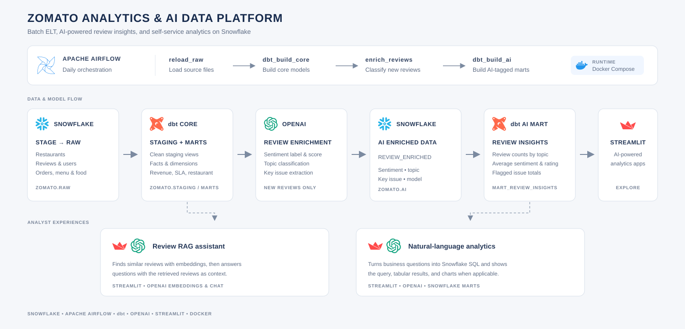

# Zomato Analytics & AI Data Platform

An end-to-end analytics engineering project that turns restaurant, order, and
customer-review data into Snowflake analytics models and AI-powered experiences.
The platform combines Apache Airflow for orchestration, dbt for transformation,
and OpenAI-powered workflows for review enrichment, semantic search, and
natural-language analytics.

## Project at a glance

- **Ingest:** Load restaurant, review, user, food, menu, order, and order-item
  files from a Snowflake stage into the `ZOMATO.RAW` schema.
- **Transform:** Use dbt staging views and analytics marts to prepare
  consistent, query-ready Snowflake data.
- **Orchestrate:** Run the daily ELT and AI review-enrichment workflow with
  Apache Airflow.
- **Enrich:** Classify review sentiment, topic, and key issue with an OpenAI
  model, then publish aggregated review insights through dbt.
- **Explore:** Ask questions of review text with retrieval-augmented generation
  (RAG), or explore business metrics with a natural-language-to-SQL app.

## Architecture



The `zomato_batch` DAG runs daily in this order:

1. `reload_raw` loads source files into Snowflake.
2. `dbt_build_core` builds the non-AI staging and mart models.
3. `enrich_reviews` classifies reviews that have not yet been enriched.
4. `dbt_build_ai` builds dbt models tagged `ai`, including the review insights
   mart.

## Analytics models

The dbt project is in [`zomato_project/`](zomato_project/). Staging models
standardize the raw restaurant, review, user, food, menu, order, and order-item
data. Staging models are views; marts are tables.

Core dimensions and facts include:

- `dim_customer`, `dim_date`, `dim_food`, and `dim_restaurants`
- `fct_orders` and `fct_order_items`

Business-facing marts include:

- `mart_daily_city_revenue` for daily city-level orders, GMV, and average order
  value
- `mart_delivery_sla` for delivery-time and late-delivery measures
- `mart_restaurant_performance` for restaurant sales and customer metrics
- `mart_review_insights` for review counts, sentiment, topics, average ratings,
  and flagged issues

## AI experiences

### Review enrichment

[`ai/enrich_reviews.py`](ai/enrich_reviews.py) reads reviews from
`ZOMATO.RAW.reviews`, classifies each review with OpenAI, and stores the
sentiment label and score, topic, key issue, model, and enrichment timestamp in
`ZOMATO.AI.review_enriched`. The dbt AI source and
[`mart_review_insights`](zomato_project/models/marts/mart_review_insights.sql)
join the enrichment data to staged reviews for analysis.

The current enrichment script processes up to 15 new reviews per run. Review
enrichment requires Snowflake access and a valid OpenAI API key.

### Review RAG

[`ai/rag_chat.py`](ai/rag_chat.py) finds relevant reviews using embeddings and
cosine similarity, then asks an OpenAI chat model to answer using the retrieved
reviews as context. The app displays the reviews used to form each response.
It reads a sample of reviews from `ZOMATO.STAGING.STG_REVIEWS` and caches
embeddings in a local Parquet file.

### Text-to-SQL

[`ai/text_to_sql.py`](ai/text_to_sql.py) translates a business question into a
Snowflake SQL query, displays the query and results, and charts results when
they contain a categorical and numeric column. It is configured with a
read-oriented prompt and basic query checks; review generated SQL before
running it.

## Repository layout

```text
.
├── .github/workflows/       # Pull-request checks and deployment packaging
├── Airflow/
│   ├── Dags/
│   │   ├── queries/         # Snowflake raw-load SQL
│   │   └── zomato_batch.py  # Daily ELT and AI workflow
│   ├── Dockerfile
│   └── docker-compose.yaml
├── ai/
│   ├── enrich_reviews.py    # OpenAI review classification
│   ├── rag_chat.py          # Semantic search and review Q&A
│   └── text_to_sql.py       # Natural-language analytics app
└── zomato_project/
    ├── dbt_project.yml
    ├── profiles.yml
    └── models/
        ├── staging/         # Cleaned source views
        └── marts/           # Facts, dimensions, and analytics marts
```

## Prerequisites

- Docker with Docker Compose
- A Snowflake account with the `ZOMATO` database, `ZOMATO_WH` warehouse,
  `DBT_ROLE`, required schemas and grants, and the `ZOMATO_RAW_STAGE` stage
  populated with the source files
- An OpenAI API key for review enrichment and the AI apps
- Python and the application dependencies to run the Streamlit apps locally
- dbt Core with the Snowflake adapter to run dbt locally

## Configuration

### Airflow

Create `Airflow/.env` (do not commit it) with the credentials used by Docker
Compose:

```dotenv
SNOWFLAKE_ACCOUNT=your-account-identifier
SNOWFLAKE_USER=your-snowflake-user
SNOWFLAKE_PASSWORD=your-snowflake-password
OPENAI_API_KEY=your-openai-api-key
```

The Airflow Snowflake connection is configured for the `ZOMATO` database,
`ZOMATO_WH` warehouse, `RAW` schema, and `DBT_ROLE`. The Docker Compose setup
creates an Airflow administrator with the local-development credentials
`admin` / `admin`; change these before exposing the service beyond a local
environment.

### Local dbt

The dbt profile in [`zomato_project/profiles.yml`](zomato_project/profiles.yml)
expects `SNOWFLAKE_ACCOUNT`, `SNOWFLAKE_USER`, and `SNOWFLAKE_PASSWORD` in the
environment. Export them in your shell before running dbt. `dbt parse` can
validate project configuration without connecting to Snowflake; `dbt build`
requires valid warehouse credentials and access.

### Local AI apps

The AI scripts load environment variables from the current working directory.
When running an app from `ai/`, create a private `ai/.env` containing the
credentials below. Do not commit credentials.

```dotenv
OPENAI_API_KEY=your-openai-api-key
SNOWFLAKE_ACCOUNT=your-account-identifier
SNOWFLAKE_USER=your-snowflake-user
SNOWFLAKE_PASSWORD=your-snowflake-password
SNOWFLAKE_WAREHOUSE=ZOMATO_WH
SNOWFLAKE_DATABASE=ZOMATO
SNOWFLAKE_SCHEMA=STAGING
```

Install the app dependencies in your Python environment (`streamlit`, `numpy`,
`pandas`, `snowflake-connector-python`, `openai`, `python-dotenv`, and
`pyarrow`). The text-to-SQL app also requires access to the `MARTS` schema.

## Run the project

### Start Airflow

From the repository root:

```bash
cd Airflow
docker compose build
docker compose up -d
```

Open the Airflow UI at <http://localhost:8080>, sign in with the local
development credentials, and enable or trigger the `zomato_batch` DAG.

Stop the stack with:

```bash
docker compose down
```

### Run dbt locally

From the repository root, after exporting the Snowflake environment variables:

```bash
dbt parse --project-dir zomato_project --profiles-dir zomato_project
dbt build --project-dir zomato_project --profiles-dir zomato_project
```

To build just the AI review insights model and its dependencies:

```bash
dbt build --project-dir zomato_project --profiles-dir zomato_project \
  --select mart_review_insights
```

### Launch an AI app

Install the dependencies listed above, configure `ai/.env`, and run commands
from the `ai/` directory:

```bash
cd ai
streamlit run rag_chat.py
```

Or launch the business analytics app:

```bash
streamlit run text_to_sql.py
```

## Quality checks

The pull-request workflow runs formatting, lint, Python compilation, optional
pytest tests, dbt parsing, and Snowflake SQL parsing. The checks do not connect
to a live Snowflake account. Run the Python checks locally from the repository
root:

```bash
black --check ai Airflow/Dags
flake8 --max-line-length=88 ai Airflow/Dags
python -m compileall -q ai Airflow/Dags
```

After a pull request is merged into `main`, the deployment workflow creates a
deployment bundle and uploads it as a GitHub Actions artifact. It does not
deploy to a runtime environment; deployment must be completed separately.

## Project scope and next steps

This project demonstrates a batch data platform for food-delivery analytics,
including source ingestion, dimensional modeling, orchestration, and applied
LLM workflows. Natural extensions include broader dbt data-quality coverage,
production secret management, deployment automation, and dashboard
integration.
